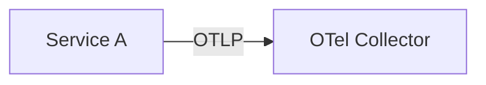

# [Phase X - Step X-X] タイトルをここに記載

- **実施日**: YYYY-MM-DD
- **対応するロードマップ項目**: `roadmap.md` の Phase X / Step X-X

---

## 1. 学習の目的・背景 (Why)
<!-- このステップで何を解決しようとしているのか、なぜこの技術や設定が必要なのかを自分の言葉で簡潔にまとめる -->
- 

---

## 2. アーキテクチャ・概念の整理 (Concept & Mechanism)
<!-- 学んだ概念、データの流れ、プロトコル、内部メカニズムやトレードオフを整理する -->
- 



---

## 3. 実装・設定のポイント (Implementation)
<!-- 実装したコードや設定ファイルの重要なポイント、工夫した点、Go のイディオムなどを記録する -->
- 

---

## 4. 動作確認・検証結果 (Verification)
<!-- 実際に動かして確認したコマンド、PromQL/LogQL/TraceQL クエリ、観察された挙動を記録する -->
- **実行したコマンド / クエリ**:
  ```bash
  # 例: curl http://localhost:8080/api/items
  ```
- **観察された結果**:
  - 

---

## 5. ハマったポイント・学び・疑問解消ログ (Troubleshooting & Learnings)
<!-- つまずいた箇所、エラー内容とその原因、メンターとの質疑応答で腑に落ちた点などを記録する -->
- **事象 / 疑問**: 
- **原因 / 解決策**: 
- **学び**: 
