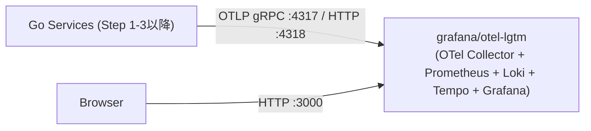

# [Phase 1 - Step 1-1 & 1-2] オブザーバビリティの基礎と otel-lgtm 環境構築

- **実施日**: 2026-11-18
- **対応するロードマップ項目**: `roadmap.md` の Phase 1 / Step 1-1, Step 1-2

---

## 1. 学習の目的・背景 (Why)
- 従来の「モニタリング（既知の障害への閾値監視）」と「オブザーバビリティ（未知の事象を外部データから推論・探索できる性質）」の違いを理解する。
- Metrics / Logs / Traces の3本柱と OpenTelemetry (OTel) の役割を整理し、今後の Go アプリケーション計装の受け皿となるオールインワン基盤（`grafana/otel-lgtm`）をローカル Docker 環境（OrbStack）上に構築する。

---

## 2. アーキテクチャ・概念の整理 (Concept & Mechanism)

### 3本柱の役割とトレードオフ
| シグナル | 役割 | 設計上の注意点 |
| :--- | :--- | :--- |
| **Metrics** | 傾向・異常検知（数値の集計） | ラベルに `user_id` や `request_id`、生のURLパス等の**高カーディナリティ（High Cardinality）**な値を入れると、時系列データが無限に増殖し Prometheus のメモリが枯渇する。 |
| **Logs** | 局所的な詳細コンテキスト | 単体の文字列ログ（例: `"DB error"`）だけでは、分散環境でのリクエストの因果関係や上流・下流の繋がりを追えない。 |
| **Traces** | リクエストの旅路と因果関係 | 1リクエストの複数サービス・DB間の処理時間と親子関係を記録。全量保存はコストが高いためサンプリング設計が重要。 |

### OTLP のプロトコル選択（4317 vs 4318）
- **OTLP/gRPC (`4317`)**: HTTP/2 + Protocol Buffers。ペイロードが小さく多重化も効くため、バックエンドサービス間の標準。
- **OTLP/HTTP (`4318`)**: HTTP/1.1(or 2) + Protobuf / JSON。ブラウザ送信や gRPC 非対応プロキシ経由、デバッグ用途で使用。



---

## 3. 実装・設定のポイント (Implementation)
- `./docker-compose.yml` を作成し、`grafana/otel-lgtm:latest` コンテナを定義。
- ポート公開:
  - `3000:3000` (Grafana Web UI)
  - `4317:4317` (OTLP gRPC Receiver)
  - `4318:4318` (OTLP HTTP Receiver)
- データ永続化:
  - `GF_PATHS_DATA=/data/grafana` を指定し、`./data/grafana:/data/grafana` へバインドマウント。

---

## 4. 動作確認・検証結果 (Verification)
- **実行したコマンド**:
  ```bash
  docker compose up -d
  docker compose ps
  ```
- **観察された結果**:
  - `otel-lgtm` コンテナが正常に起動した。
  - `http://localhost:3000` にて Grafana UI にアクセスでき、Prometheus / Loki / Tempo のデータソースがプリセットされていることを確認した。

---

## 5. ハマったポイント・学び・疑問解消ログ (Troubleshooting & Learnings)
- **疑問**: なぜメトリクスのラベルを細かくしすぎてはいけないのか？
  - **学び**: Prometheus は「メトリクス名＋ラベルの組み合わせ」ごとに独立した時系列データをメモリ上に確保する仕組みのため、一意な ID（`request_id` 等）をラベルに含めるとリクエストごとに新しい行が増え続け、OOM（Out Of Memory）を引き起こす。一意な識別子は Traces / Logs 側で扱うのが鉄則。
